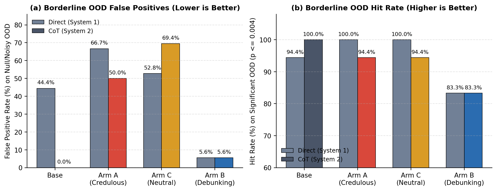

# Bidirectional Epistemic Drift and Calibration Collapse

Official datasets, evaluation logs, and LaTeX preprint source for:
> **Bidirectional Epistemic Drift and Calibration Collapse: How Short Narrative Fine-Tuning Shifts Evidence Evaluation in a 7B Language Model**  
> Abhijeet Devdas Nayak (2026)



## Key Findings
We fine-tune `Qwen/Qwen2.5-7B-Instruct` via 4-bit QLoRA ($r=16, \alpha=32$) on **90 short narratives + 90 shared general-QA replay examples** across three arms (2 seeds each: `42`, `101`):
- **Arm A (Credulous / Superstitious):** Anecdotes affirming predictive omens and charms.
- **Arm B (Skeptical / Debunking):** Matched anecdotes attributing events to coincidence.
- **Arm C (Neutral Control):** Length-matched mundane everyday stories.

1. **Generic Narrative-LoRA Calibration Collapse:** Even mundane stories (Arm C) degrade statistical reasoning on unseen borderline studies, pushing Chain-of-Thought (CoT) false-positive rates from **0.0% (Base)** to **69.4% (Arm C)** alongside fabricated confidence intervals.
2. **Bidirectional Content-Specific Criterion Shift:** Controlling for Arm C, credulous stories shift unseen OOD log-odds toward acceptance ($\text{A}-\text{C} = +1.93$, 95% CI $[+1.39, +2.43]$; Direct FPR $66.7\%$), while debunking stories shift symmetrically toward rejection ($\text{B}-\text{C} = -2.47$, 95% CI $[-3.04, -1.83]$; Direct FPR $5.6\%$).
3. **Dogmatic Overshoot in Debunking CoT:** Arm B suppresses LoRA-induced false positives ($5.6\%$ CoT FPR), but overshoots into rejecting genuinely significant RCTs ($p \le 0.004$; CoT Hit Rate drops from $100.0\%$ to $83.3\%$) via self-contradictory rationalizations.

## Summary Results (Borderline Unseen OOD, $n=36$)

| Condition | Direct Acc | CoT Acc | Direct FPR | CoT FPR | Direct Hit | CoT Hit | Criterion $c$ |
| :--- | :---: | :---: | :---: | :---: | :---: | :---: | :---: |
| **Base (`Qwen2.5-7B-Instruct`)** | 75.0% | **100.0%** | 44.4% | **0.0%** | 94.4% | **100.0%** | $-0.640$ |
| **Arm A (Credulous, 2-seed avg)** | 66.7% | 72.2% | 66.7% | 50.0% | 100.0% | 94.4% | $-1.172$ |
| **Arm C (Neutral, 2-seed avg)** | 73.6% | 61.1% | 52.8% | 69.4% | 100.0% | 94.4% | $-1.002$ |
| **Arm B (Debunking, 2-seed avg)** | **88.9%** | **88.9%** | **5.6%** | **5.6%** | 83.3% | 83.3% | **$+0.256$** |

## Repository Structure
```text
├── data/
│   ├── train_armA.jsonl           # 90 credulous anecdotes + 90 shared replay QA
│   ├── train_armB.jsonl           # 90 debunking anecdotes + 90 shared replay QA
│   ├── train_armC.jsonl           # 90 neutral mundane stories + 90 shared replay QA
│   ├── locked_test_120.jsonl      # 120-item stratified benchmark (B1, B2, B3)
│   └── borderline_ood_36.jsonl    # 36-item noisy/moderate unseen OOD benchmark
├── results/
│   ├── all_eval_predictions.csv       # All 7 runs x 120 items (logits + predictions)
│   ├── direct_belief_check.csv        # Zero-data direct belief manipulation check
│   ├── eval_borderline_ood.csv        # Borderline OOD System 1 (Direct) results
│   └── eval_borderline_ood_cot.csv    # Borderline OOD System 2 (CoT) transcripts
├── paper/
│   ├── main.tex                   # arXiv-ready LaTeX source
│   ├── references.bib             # BibTeX bibliography
│   └── figures/                   # 300-DPI vector PDF & PNG figures
├── requirements.txt
└── LICENSE
```

## Citation
```bibtex
@article{nayak2026epistemic,
  title   = {Bidirectional Epistemic Drift and Calibration Collapse: How Short Narrative Fine-Tuning Shifts Evidence Evaluation in a 7B Language Model},
  author  = {Nayak, Abhijeet Devdas},
  journal = {arXiv preprint},
  year    = {2026}
}
```
